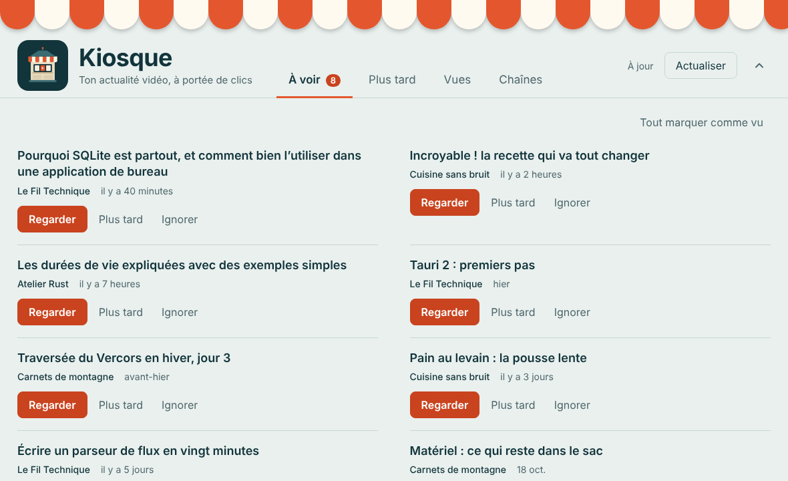
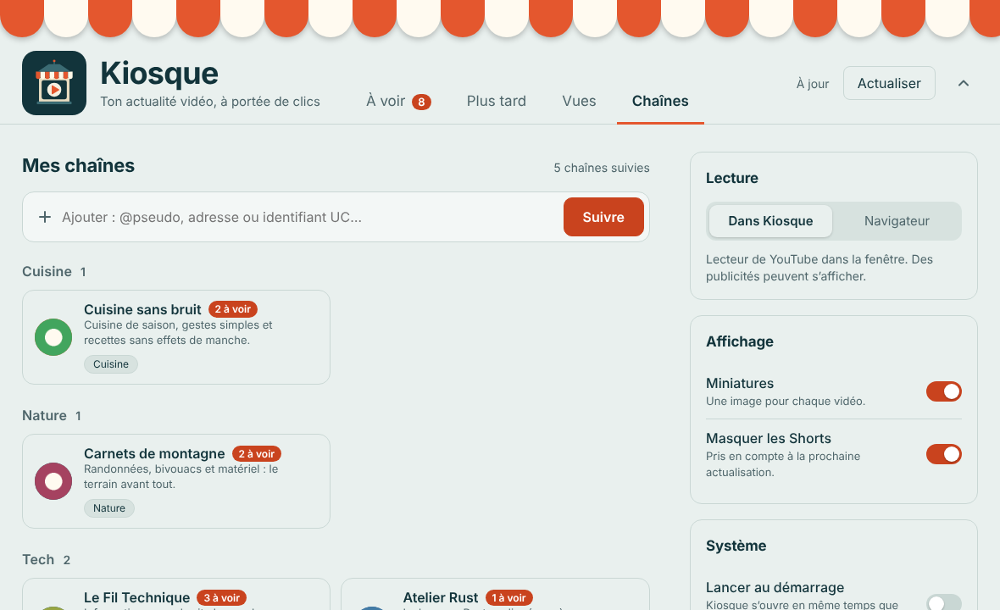
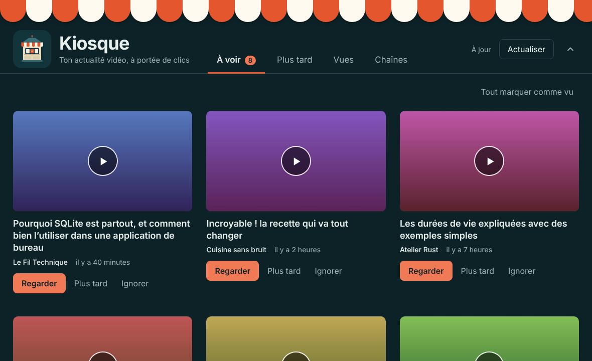
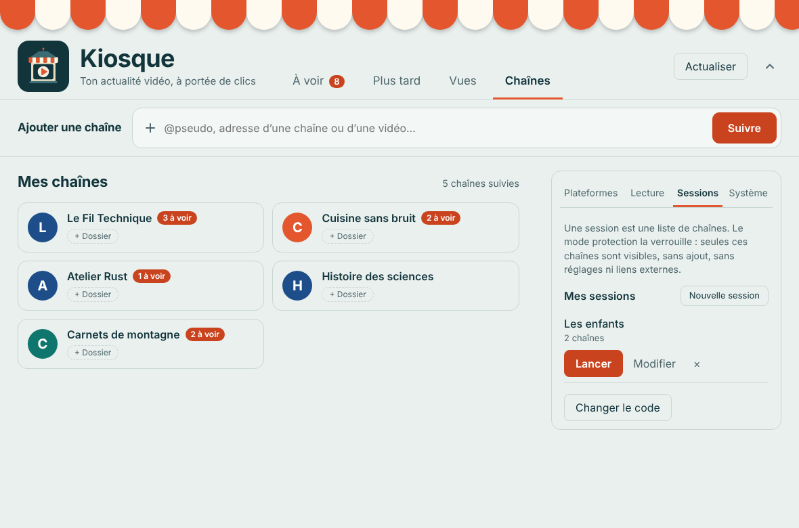
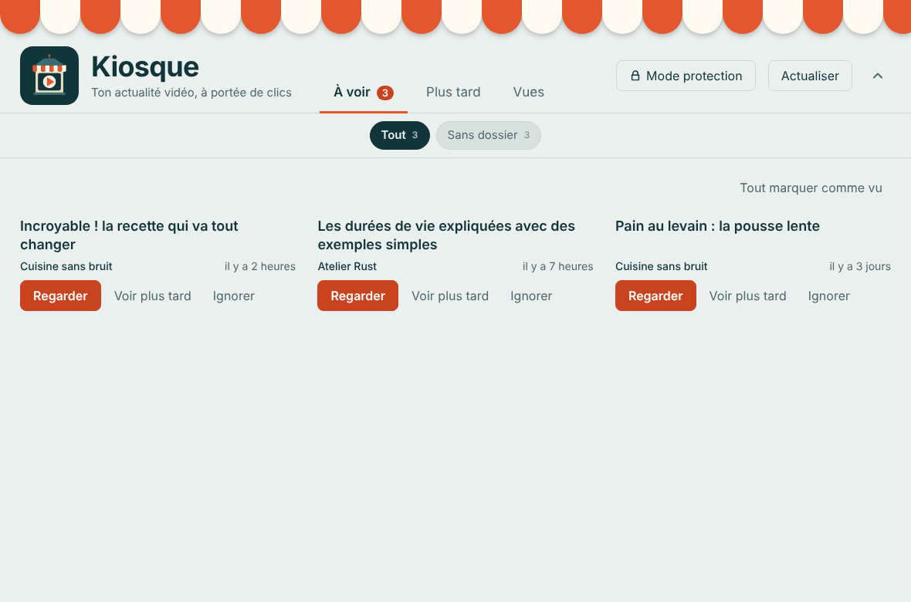
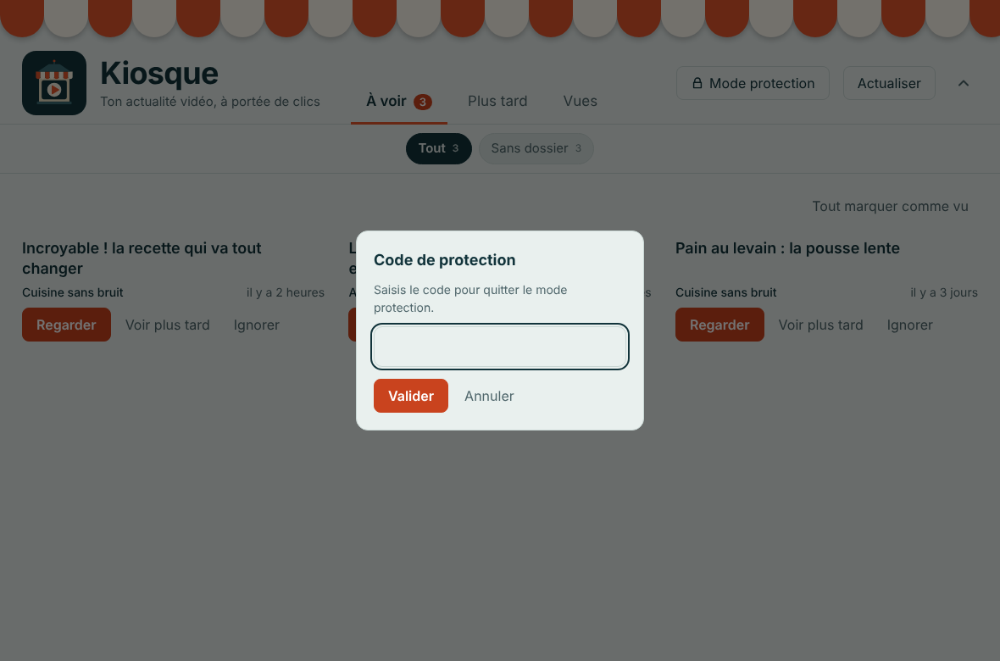
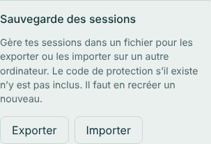

# Kiosque

Un lecteur de chaînes YouTube qui se termine. Tu choisis les chaînes, Kiosque affiche leurs nouvelles vidéos dans une boîte de réception, et quand elle est vide, c'est fini : pas de recommandations, pas de fil sans fin, pas d'autoplay.

Application de bureau en Rust avec [Tauri 2](https://v2.tauri.app/). Aucun compte Google, aucune clé d'API : Kiosque lit les flux RSS publics des chaînes.





<details>
<summary>Thème sombre</summary>



</details>

Les aperçus montrent des chaînes d'exemple, dont les miniatures et les avatars sont des images de remplacement. L'interface suit le thème de ton système, et la barre du haut se réduit avec la flèche à droite.

## Télécharger

Dans l'onglet **Releases** du dépôt, les fichiers sont toujours numérotés avec la version :

| Fichier | Pour qui |
| --- | --- |
| `Kiosque_X.Y.Z_portable.exe` | **Version portable** : aucune installation, tu le lances d'un double-clic et tu peux le garder sur une clé USB. |
| `Kiosque_X.Y.Z_x64-setup.exe` | Installeur Windows : ajoute Kiosque au menu Démarrer et se désinstalle comme un programme normal. |
| `Kiosque_X.Y.Z_universal.dmg` | **macOS** (Mac Intel et Apple Silicon). *Non testé.* |
| `Kiosque_X.Y.Z_amd64.AppImage` | **Linux** : un seul fichier à rendre exécutable, sans installation. *Non testé.* |
| `Kiosque_X.Y.Z_amd64.deb` | **Linux** (Debian, Ubuntu et dérivés) : se double-clique pour l'installer. *Non testé.* |

Les fichiers Windows ne sont pas signés : au premier lancement, Windows (SmartScreen) affiche un avertissement. Clique sur « Informations complémentaires », puis « Exécuter quand même ». La version portable utilise WebView2, déjà présent sur Windows 10 et 11.

### macOS et Linux (non testés)

Les mêmes versions existent pour **macOS** (`Kiosque_…_universal.dmg`) et **Linux** (`Kiosque_….AppImage` ou `.deb`), construites automatiquement par GitHub. **Elles n'ont jamais été essayées sur un vrai Mac ou un vrai Linux** : le programme y compile, mais l'affichage, le lecteur ou les notifications peuvent présenter des défauts. Si tu as un Mac ou un Linux, tu peux les essayer et signaler ce qui ne va pas dans l'onglet **Issues** du dépôt GitHub.

Sur macOS, le fichier n'est pas signé par un compte développeur : au premier lancement, fais un clic droit sur l'application, puis « Ouvrir ». La mise à jour dans l'application n'existe que sous Windows pour l'instant ; ailleurs, le bouton « Mettre à jour » ouvre la page de la release.

## Construire les fichiers (GitHub)

Un workflow GitHub (`.github/workflows/release.yml`) construit l'installeur et la version portable pour Windows, puis les fichiers macOS et Linux, sur les serveurs de GitHub : rien à installer ni à compiler chez toi, et aucun Go de plus sur ton disque.

1. Crée un dépôt vide sur github.com (sans README), puis, dans PowerShell, dans le dossier du projet :
   ```
   git init
   git add .
   git commit -m "Kiosque"
   git branch -M main
   git remote add origin https://github.com/TON-COMPTE/kiosque.git
   git push -u origin main
   ```
2. Lance la construction : onglet **Actions → Construire Kiosque → Run workflow**. Compte une dizaine de minutes la première fois, moins ensuite.
3. Va dans **Releases** : la release publiée contient `Kiosque_0.1.0_x64-setup.exe` (installeur) et `Kiosque_0.1.0_portable.exe` (aucune installation : tu le lances directement). Télécharge celui que tu préfères.

Les versions s'incrémentent toutes seules : à chaque `publier.cmd` qui envoie un changement du programme, le dernier chiffre augmente (0.1.0 → 0.1.1) dans `tauri.conf.json`, `package.json` et `Cargo.toml`, et GitHub publie une release portant ce numéro. Pour changer le début du numéro (0.2.0, 1.0.0), modifie `version` à la main dans `src-tauri/tauri.conf.json` : `publier.cmd` repartira de là.

L'installeur n'est pas signé : Windows (SmartScreen) affiche un avertissement au premier lancement. Clique sur « Informations complémentaires », puis « Exécuter quand même ».

Windows est construit en premier ; macOS et Linux ne démarrent que s'il réussit. Sur un dépôt privé, les minutes macOS sont comptées dix fois plus vite que celles de Windows.

## Lancer le projet sur ta machine

Seulement si tu veux modifier le code. Prérequis : [Rust](https://rustup.rs), [Node.js](https://nodejs.org) et les dépendances système de Tauri pour ton OS ([guide officiel](https://v2.tauri.app/start/prerequisites/)).

```bash
npm install
npm run dev      # fenêtre de développement
```

Sous Windows, `construire.bat` fabrique l'installeur avec ton Rust local (`src-tauri\target` pèse alors quelques Go : supprime-le après coup).

## Utilisation

- **Chaînes** : colle une adresse de chaîne, un `@pseudo` ou un identifiant `UC…`, puis « Suivre ». Coller l'adresse d'une vidéo fonctionne aussi : Kiosque suit sa chaîne.
- **À voir** : les nouvelles vidéos, de la plus récente à la plus ancienne. Pour chacune : Regarder, Plus tard ou Ignorer. « Tout marquer comme vu » vide la boîte d'un coup.
- **Plus tard / Vues** : les vidéos mises de côté et l'historique de ce que tu as ouvert.
- **Lecture** : dans la fenêtre de Kiosque (lecteur YouTube avec les commandes de Kiosque, publicités possibles) ou dans ton navigateur, au choix dans Chaînes. Une vidéo dont l'auteur interdit l'intégration s'ouvre avec « Ouvrir dans le navigateur ».
- **Plateformes** : YouTube par défaut. Dans Chaînes → Plateformes, tu peux activer PeerTube, Odysee et Vimeo (Dailymotion est mis de côté pour le moment : il refuse la lecture dans l'application), puis coller l'adresse d'une chaîne. Ces vidéos se lisent avec le lecteur de leur plateforme. Twitch, Rumble ou Netflix ne proposent pas de flux public exploitable.

À l'ajout d'une chaîne, ses vidéos de plus de 7 jours sont directement rangées dans « Vues » pour que la boîte de réception ne démarre pas pleine d'archives.

Les titres entièrement en majuscules sont remis en minuscules (le titre d'origine s'affiche au survol) et les miniatures sont masquées par défaut (case à cocher dans Chaînes).

## Sessions et mode protection

Dans **Chaînes → Sessions**, tu crées des sessions : des listes de chaînes (« Les enfants », « Info »…). Le **mode protection** verrouille Kiosque sur une session :

- seules les chaînes de la session sont visibles (vidéos, compteurs, filtres) ;
- plus d'onglet Chaînes, de réglages, d'ajout de chaîne, de liens externes ni de mise à jour ;
- on en sort avec le **code de protection**, via le bouton cadenas en haut à droite.

**Le code de protection** (4 chiffres) est **unique : il est valable pour toutes les sessions**, y compris celles créées ou importées plus tard. Kiosque le demande à la création de la première session ; laissé vide, il vaut `0000` (pense à le changer). Ensuite, « Changer le code » demande l'ancien code puis le nouveau.

Le verrou est appliqué aussi côté Rust (l'interface seule ne suffit pas) ; le code est stocké salé et haché, et les essais ratés sont espacés dans le temps. Le mode reste actif après redémarrage.









**Sauvegarde et transfert** : dans Chaînes → Système, « Exporter » écrit `kiosque-sessions.json` dans le dossier Téléchargements (noms de sessions et chaînes, jamais le code de protection). Sur un autre ordinateur, « Importer » lit ce fichier sans jamais écraser une session existante (un nom déjà pris reçoit un numéro). Les chaînes que cet ordinateur ne suit pas encore sont listées, et « Suivre les chaînes manquantes » les ajoute (une plateforme désactivée n'est pas activée d'office). Si le nouvel ordinateur n'a pas encore de code de protection, Kiosque t'en fait créer un après l'import (laissé vide, il vaut `0000` : change-le). Un code déjà défini n'est jamais modifié par un import.

**Code oublié** : il n'existe volontairement aucun moyen de le contourner. Il faut supprimer la base de données (`kiosque.sqlite3`, voir « Où sont les données ») et réajouter tes chaînes, ou réinstaller après avoir supprimé le dossier de données.

**Limites honnêtes** : c'est un garde-fou pour la maison, pas un contrôle parental de sécurité. Un enfant à l'aise avec l'ordinateur peut contourner (fermer l'appli, supprimer les données, ouvrir YouTube dans un navigateur). Les vidéos « à voir / vues » sont communes à tout le monde : ce qu'un enfant regarde apparaît dans l'historique. Une fois la vidéo lancée, YouTube garde ses propres liens (logo, suggestions de fin) dans le lecteur.

## Où sont les données

Dans un fichier SQLite local, `kiosque.sqlite3`, dans le dossier de données de l'application :

- Windows : `%APPDATA%\fr.kiosque.reader\`
- macOS : `~/Library/Application Support/fr.kiosque.reader/`
- Linux : `~/.local/share/fr.kiosque.reader/`

Aucune télémétrie. Kiosque ne contacte que `youtube.com` (flux RSS, et la page de la chaîne au moment de l'ajout).

## Architecture

```
src/            interface (HTML, CSS, JS sans bundler)
src-tauri/src/
  feed.rs       lecture des flux Atom YouTube (feed-rs)
  resolve.rs    adresse / @pseudo / UC… → identifiant de chaîne
  db.rs         SQLite : chaînes, vidéos, états, réglages
  lib.rs        commandes Tauri exposées à l'interface
```

Les tests couvrent le parsing des flux, la résolution des adresses et la base de données : `cd src-tauri && cargo test`.

## Limites à connaître

- Un flux RSS ne contient que les **15 dernières vidéos** d'une chaîne. Suffisant pour un fil d'actualité, pas pour parcourir un catalogue.
- Les **Shorts** sont masqués en lisant la playlist « vidéos longues » (`UULF…`). C'est une astuce non documentée par YouTube : si elle cesse de fonctionner, Kiosque retombe sur le flux classique (Shorts inclus), et tu peux désactiver l'option dans Chaînes.
- La durée des vidéos n'est pas dans le flux, donc pas de filtre par durée pour l'instant.
- Les flux RSS sont stables depuis des années, mais ce n'est pas une API officielle garantie.
- Si YouTube affiche une page de consentement au moment d'ajouter une chaîne par `@pseudo`, colle plutôt l'adresse `youtube.com/channel/UC…` ou l'identifiant `UC…`.

## Pistes pour la suite

Règles par chaîne (digest hebdomadaire, durée minimale), filtres de mots-clés, budget de temps quotidien, import de tes abonnements (OPML ou export Google Takeout), connexion OAuth pour les likes et commentaires (optionnelle).

<!-- Version de test de la mise à jour interne (0.2.2). -->
